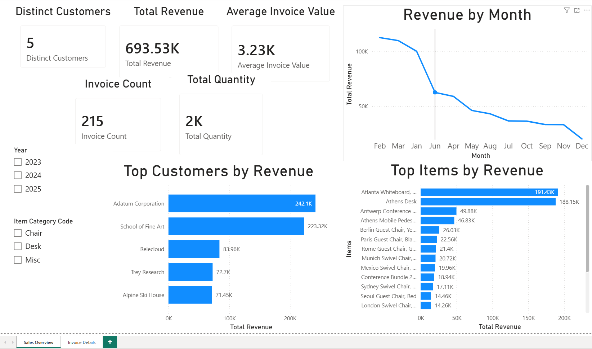
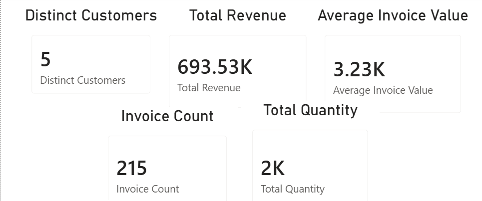
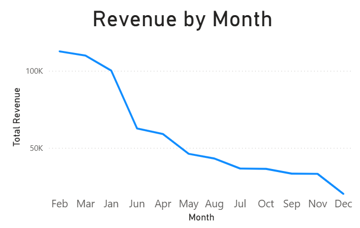
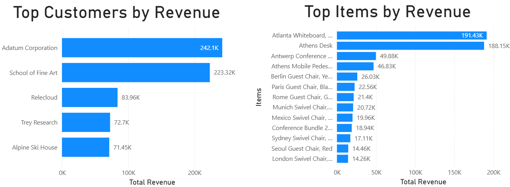
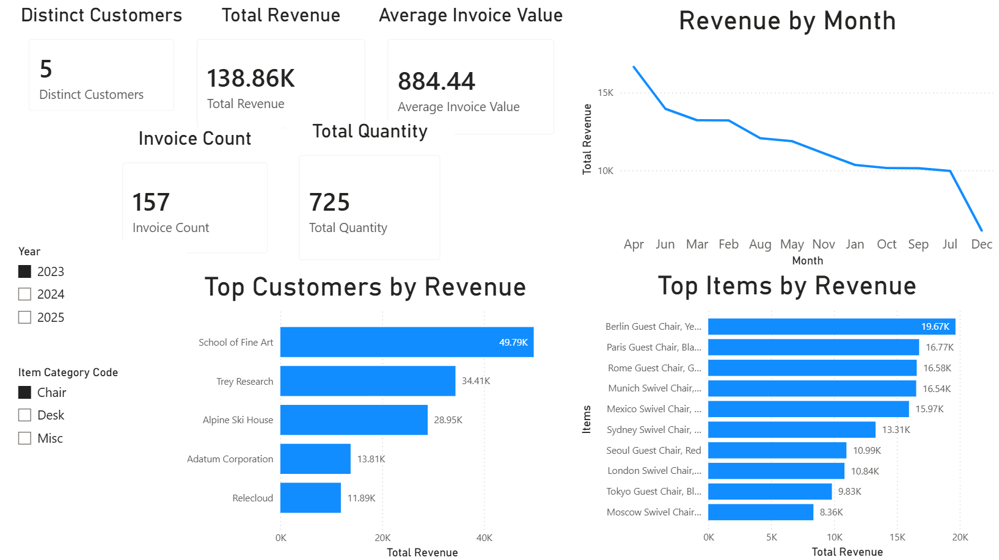
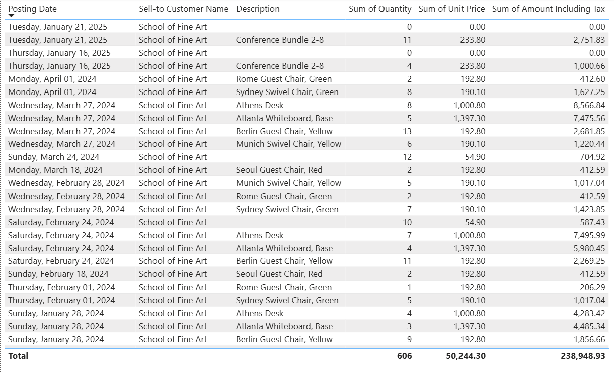
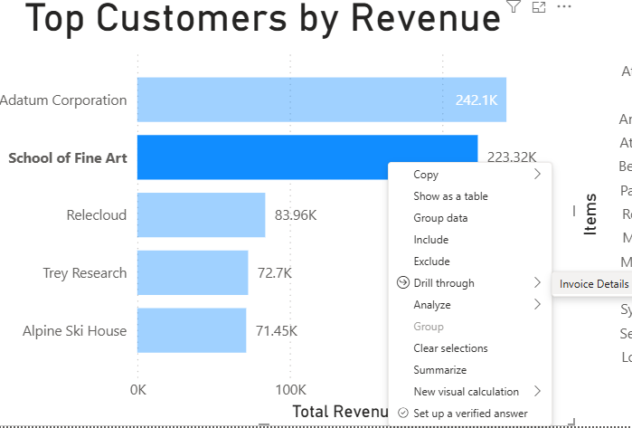

# Business Central Sales Insights Dashboard

## Description

A Power BI report and data model built on sales data from the CRONUS database in Microsoft Dynamics 365 Business Central. 

The dashboard features:

- High-level sales KPIs  
- Revenue trends over time  
- Top customers and products by revenue  
- Ability to drill-through to the invoice details table for quick analysis  

All data is loaded from Business Central via configuration packages and staged in Excel before being modeled in Power BI Desktop.

## Objective

Provide a sales overview dashboard that shows:

- **How much is being sold** (Total Revenue, Invoice Count, Quantity)
- **Who is buying** (Top Customers by Revenue)
- **What is selling** (Top Items by Revenue)
- **When sales are happening** (Revenue by Month)
- **What’s behind the numbers** (Invoice-level drill-through)

## Technologies

- **Power BI Desktop** – data model, DAX measures, and report layout  
- **Power Query** – data shaping and loading from Excel staging files  
- **Excel** – staging area for configuration package exports  
- **Dynamics 365 Business Central (CRONUS demo database)** – source system  
  - Sales Invoice Header (Table 112)  
  - Sales Invoice Line (Table 113)  
  - Customer (Table 18)
  - Item (Table 27)
- **Git + GitHub** – version control

## Data Model

The data model is in a star schema layout with one fact table and four dimension tables:

- **Fact**
  - `Sales-Invoice-Line`
- **Dimensions**
  - `Sales-Invoice-Header`
  - `Customer`
  - `Item`
  - `Date` (calculated table)

Key relationships:

- `Sales-Invoice-Line[Document No.]` → `Sales-Invoice-Header[No.]`
- `Sales-Invoice-Header[Sell-to Customer No.]` → `Customer[No.]`
- `Sales-Invoice-Line[No.]` → `Item[No.]`
- `Sales-Invoice-Header[Posting Date]` → `Date[Date]`



### Measures

All core metrics are defined as DAX measures in a dedicated **Measures-Table**:

- `Total Revenue` – sum of `Sales-Invoice-Line[Amount]`  
- `Invoice Count` – distinct count of invoices using `Sales-Invoice-Header[No.]`  
- `Distinct Customers` – distinct count of customers using `Sales-Invoice-Header[Sell-to Customer No.]`  
- `Total Quantity` – sum of `Sales-Invoice-Line[Quantity]`  
- `Average Invoice Value` – `DIVIDE([Total Revenue], [Invoice Count])`

```DAX
Total Revenue =
SUM ( 'Sales-Invoice-Line'[Amount] )

Invoice Count =
DISTINCTCOUNT ( 'Sales-Invoice-Header'[No.] )

Distinct Customers =
DISTINCTCOUNT ( 'Sales-Invoice-Header'[Sell-to Customer No.] )

Total Quantity =
SUM ( 'Sales-Invoice-Line'[Quantity] )

Average Invoice Value =
DIVIDE ( [Total Revenue], [Invoice Count] )
```

These measures power all visuals on the Sales Overview page.

## Report Pages

### 1. Sales Overview

High-level KPIs, trend analysis, and top customers and top items views.

#### KPIs



Cards across the top of the page highlight:

- Distinct Customers
- Total Revenue
- Average Invoice Value
- Invoice Count
- Total Quantity

These respond to all slicers and filters on the page.

#### Revenue by Month



A line chart using the `Date` table shows `Total Revenue` by Month, giving quick insights into seasonality and overall trends.

#### Top Customers & Top Items



Side-by-side bar charts showing:

- **Top Customers by Revenue** – ranked by `Total Revenue`
- **Top Items by Revenue** – ranked by `Total Revenue`

These visuals also provide the entry point for drill-through into invoice details.

#### Slicers



Two main slicers enable fast filtering:

- **Year** – filters the Date table, which propagates to all visuals
- **Item Category Code** – filters items and related sales

This combination provides options to quickly filter by year and product category.

### 2. Invoice Details

A detail page that acts as a drill-through destination from the sales overview page.



The main visual is a table with:

- Posting Date  
- Sell-to Customer Name  
- Item Description  
- Quantity (sum)  
- Unit Price (sum)  
- Amount Including Tax (sum)  

This page is configured for drill-through on:

- `Customer[Name]`
- `Item[Description]`

## Interactions & Drill-Through

### Filtering

- Use **Year** and **Item Category Code** slicers to restrict the time period and product families.
- KPIs, trend line, and bar charts respond instantly to slicer changes.

### Drill-Through to Invoice Details

From either bar chart on the Sales Overview page:

1. Right-click a customer or item bar.  
2. Choose **Drill through → Invoice Details**.



The Invoice Details page opens, pre-filtered to that specific customer or item, showing all corresponding invoices and line-level amounts.

## Usage Guide

### Refreshing the Dashboard with a Different Company or Environment

1. Export the same tables (Sales Invoice Header & Line, Customer, Item) from another Business Central company using Configuration Packages.

2. Replace the Excel files in the `Data` folder, keeping sheet and column names consistent.

3. Open the `.pbix` in Power BI Desktop.

4. Update file paths in Power Query if needed.

5. Click **Refresh** to rebuild the model and visuals with the new data.

## License
- [MIT License](LICENSE)